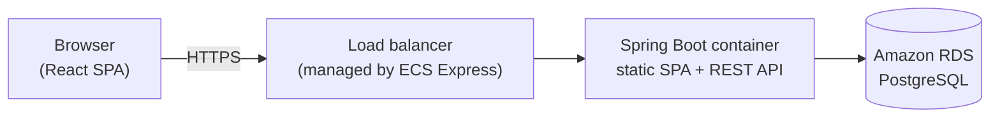
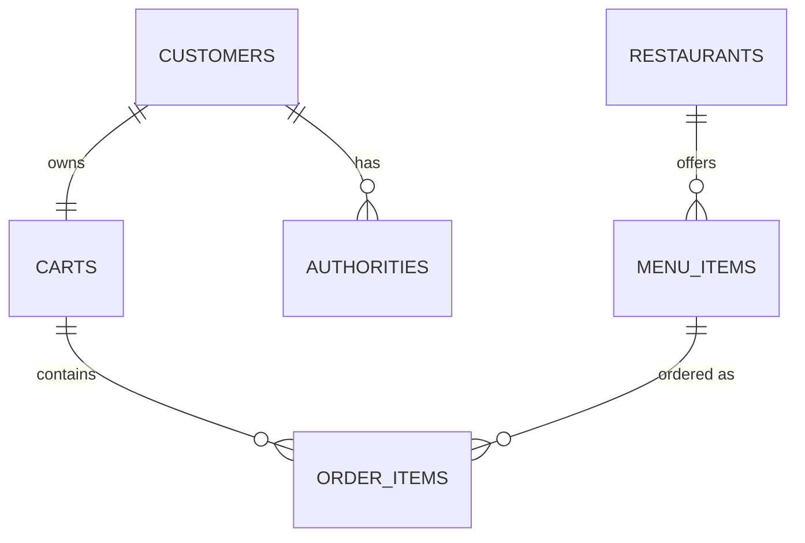

# OnlineOrder — QuickBite Backend

Spring Boot REST API for **QuickBite**, a DoorDash-style food ordering web app. Users can browse restaurants and menus, sign up and log in, add dishes to a cart, and check out.

The frontend lives in a separate repo: [quickbite](https://github.com/luyuyang34-afk/quickbite). In production, the built frontend is copied into this project's `src/main/resources/public/`, so a single container serves both the UI and the API.

## Tech Stack

| Area | Technology |
|---|---|
| Language / build | Java 21, Gradle |
| Framework | Spring Boot 4.1, Spring MVC, Jackson (snake_case JSON) |
| Data access | Spring Data JDBC, PostgreSQL |
| Auth | Spring Security form login, session cookie (`JSESSIONID`), bcrypt password hashing, `JdbcUserDetailsManager` |
| Caching | Spring Cache + Caffeine (60s TTL) |
| Testing | JUnit 5, Mockito |
| DevOps | Docker Compose (local DB), Cloud Native Buildpacks (`bootBuildImage`), AWS ECR, ECS Express Mode, RDS for PostgreSQL |

## Architecture



Inside the application, requests flow through three layers:

| Layer | Classes | Responsibility |
|---|---|---|
| `controller` | `MenuController`, `CartController`, `CustomerController` | Map HTTP requests; get the logged-in user via `@AuthenticationPrincipal` |
| `service` | `RestaurantService`, `MenuItemService`, `CartService`, `CustomerService` | Business logic, `@Transactional`, `@Cacheable` / `@CacheEvict` |
| `repository` | `ListCrudRepository` interfaces | Derived queries (e.g. `getByRestaurantId`) and custom SQL with `@Query` / `@Modifying` |
| `entity` / `model` | Java records | Entities map to tables; DTOs shape the JSON responses |

## API

| Method | Path | Auth | Description |
|---|---|---|---|
| GET | `/restaurants/menu` | Public | All restaurants, each with its menu |
| GET | `/restaurant/{restaurantId}/menu` | Public | Menu of one restaurant |
| POST | `/signup` | Public | JSON `{email, password, first_name, last_name}`; creates the user and an empty cart; returns `201` |
| POST | `/login` | Public | Form-urlencoded `username` (email) and `password`; sets the `JSESSIONID` cookie |
| POST | `/logout` | Public | Ends the session |
| GET | `/cart` | Logged in | Current user's cart: items and total price |
| POST | `/cart` | Logged in | JSON `{"menu_id": 1}`; adds one of that dish to the cart |
| POST | `/cart/checkout` | Logged in | Checks out and empties the cart |

Requests to protected endpoints without a valid session get `401 Unauthorized`.

Ready-made Postman requests are in [`postman/`](postman/).

## Data Model



- Each customer has exactly one cart.
- `order_items` stores the price at the time the dish was added, plus the quantity.
- The schema and seed data (3 restaurants with menus) are in [`database-init.sql`](src/main/resources/database-init.sql).

## Key Flows

- **Sign up.** In one transaction:
  1. Create the user with a bcrypt-hashed password through `UserDetailsManager`.
  2. Save the first and last name.
  3. Create an empty cart.
- **Add to cart.**
  1. Look up the customer's cart.
  2. If the dish is already in the cart, increase its quantity by 1. Otherwise, insert a new order item with quantity 1 and the current menu price.
  3. Update the cart total and evict the cached cart.
- **Get cart.** The result is cached per customer in Caffeine.
- **Restaurants and menus.** One query loads the restaurants and one loads all menu items. They are grouped in memory, which avoids N+1 queries. The result is cached.

## Run Locally

Prerequisites: JDK 21 and Docker.

```bash
docker compose up -d   # PostgreSQL 18 on localhost:5432
./gradlew bootRun      # API on http://localhost:8080
```

On every startup, `database-init.sql` drops and recreates all tables, then reloads the seed data. Set `INIT_DB=never` to keep existing data.

Run the tests (the context-load test needs the local database running):

```bash
./gradlew test
```

### Configuration

| Environment variable | Default | Description |
|---|---|---|
| `DATABASE_URL` | `localhost` | Database host |
| `DATABASE_PORT` | `5432` | Database port |
| `DATABASE_USERNAME` | `postgres` | Database user |
| `DATABASE_PASSWORD` | `secret` | Database password (local default only) |
| `INIT_DB` | `always` | `always` runs `database-init.sql` on startup; `never` skips it |

## Deploy to AWS

1. **Bundle the frontend.** In the [quickbite](https://github.com/luyuyang34-afk/quickbite) repo, run `npm run build`. Copy the contents of `dist/` into `src/main/resources/public/`.
2. **Build the image** with Cloud Native Buildpacks. No Dockerfile is needed.
   ```bash
   ./gradlew bootBuildImage --imagePlatform=linux/amd64 \
     --imageName=<ACCOUNT_ID>.dkr.ecr.<REGION>.amazonaws.com/onlineorder:latest
   ```
3. **Push the image to ECR.**
   ```bash
   aws ecr get-login-password --region <REGION> | docker login --username AWS --password-stdin <ACCOUNT_ID>.dkr.ecr.<REGION>.amazonaws.com
   docker push <ACCOUNT_ID>.dkr.ecr.<REGION>.amazonaws.com/onlineorder:latest
   ```
4. **Create the database.** Create an RDS for PostgreSQL instance with a database named `onlineorder`.
5. **Create the service.** Create an ECS Express Mode service from the image:
   - container port `8080`
   - health check path `/`
   - the environment variables above

   ECS Express provisions the load balancer, HTTPS endpoint, and autoscaling.

## Future Improvements

- Use `BigDecimal` instead of `Double` for prices.
- Return `404` instead of `500` when a menu item ID does not exist. This means replacing `Optional.get()` with `orElseThrow`.
- Make the cart-total update atomic, for example with `total_price = total_price + ?` in SQL. This avoids lost updates under concurrent requests.
- Load a cart's menu items in one batch query instead of one query per item.
- Move sessions and cache to Redis (Spring Session) so that multiple instances share state.
- Enable CSRF protection.
- Save order history at checkout.
- Store the database password in AWS Secrets Manager.
